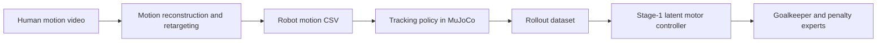

# Video to Policy

A robotics research workspace connecting **video-based motion retargeting**, **humanoid motion
tracking** and **hierarchical reinforcement learning**. The experiments focus on the
**Booster T1, 23-DoF** robot, including goalkeeper and penalty-shot tasks in simulation.

This repository brings together two pinned submodules, launch scripts and experiment reports.
The learning and simulation code lives in the project fork of `mjlab`; video processing and
retargeting live in `human_to_robot`.

## Pipeline



The tracking policy provides demonstrations for a reusable motor controller. Task-specific
policies then produce latent commands decoded into joint targets, separating task decisions
from low-level motion generation.

## What is in the project

| Component | Contents |
| --- | --- |
| [`human_to_robot`](human_to_robot) | Video-to-robot pipeline maintained in [michelebri/human_to_robot](https://github.com/michelebri/human_to_robot), including GVHMR/GMR integration and motion export |
| [`mjlab`](mjlab) | Project fork of [MuJoCo Lab](https://github.com/mujocolab/mjlab), with Booster T1 integration, tracking, motor-controller training and task-specific environments |
| [`utils_nostre/general_api.md`](utils_nostre/general_api.md) | Command reference for conversion, tracking, rollout collection and training |
| [`utils_nostre/motion_controller_report.md`](utils_nostre/motion_controller_report.md) | Stage-1 model, data contract, normalization and runtime decoding |
| [`utils_nostre/txt_goalkeeper`](utils_nostre/txt_goalkeeper) | Goalkeeper task commands, experiment plans and reward reports |
| [`utils_nostre/txt_penalty`](utils_nostre/txt_penalty) | Penalty-task plans, motion lists and expert report |
| [`utils_nostre`](utils_nostre) | Docker launchers and experiment setup helpers |

The project-specific code in the `mjlab` fork includes CSV conversion and mirroring for the
Booster T1, clip-aware rollout collection, an NPMP-style latent motor controller, and
specialized goalkeeper and penalty environments. The underlying simulator and RL framework
remain upstream work; see [credits](#credits-and-licenses).

## Getting started

### Clone with submodules

```bash
git clone --recurse-submodules https://github.com/rotellini9809/video_to_policy.git
cd video_to_policy
```

For an existing checkout:

```bash
git submodule update --init --recursive
```

Use the pinned submodule revisions when reproducing an experiment. Updating a submodule to
its latest branch can change task configurations, command interfaces and artifact contracts.

### Set up each environment

The video and training pipelines have separate dependencies:

- **Video processing:** follow the [pinned human-to-robot setup](https://github.com/michelebri/human_to_robot/blob/02f0213a7b28b505b32421825895faa0f83d486d/README.md), including model dependencies and `config.yaml`.
- **Policy training:** follow the [pinned mjlab setup](https://github.com/rotellini9809/mjlab/blob/6c1f4a9052b1e1b67969fe51a980b6db58d0edb0/README.md), using the local `mjlab` submodule. Training requires an NVIDIA GPU; Python dependencies are managed with `uv`.
- **Experiment artifacts:** workflows reference Weights & Biases runs and motion artifacts. Supply your own accessible runs, checkpoints and input videos; cloning this repository alone does not supply a trained policy.

The supplied Docker helpers target a Linux/NVIDIA environment. They configure GPU, display and
host mounts; inspect the scripts before using them on your machine. The current shared helper
requests privileged access and exposes the Docker socket, so these scripts are development
conveniences rather than an isolated deployment environment.

### Process a video

After installing the video environment and configuring its output directory and robot:

```bash
cd human_to_robot
python video_to_robot.py input_video/video.mp4 --config config.yaml
cd ..
```

The same entry point accepts an input directory. Generated artifacts include retargeted motion
and joint poses; CSV export is available when the selected robot has a converter. See the
submodule documentation for the exact output layout.

### Work with training tasks

From the `mjlab` directory, after dependency setup:

```bash
cd mjlab
uv run list-envs
uv run train --help
uv run play --help
```

Start with the [general command reference](utils_nostre/general_api.md) and supply the motion
artifact or trained run required by the selected task. The reference includes CSV-to-NPZ
conversion, motion tracking, rollout collection, Stage-1 training and evaluation.

Some experiment notes use short aliases such as `train-motor-stage1`. The pinned
`pyproject.toml` does not register those aliases. Their implementation is in
`mjlab/src/mjlab/scripts/`, including `collect_rollouts.py`,
`train_motor_controller_stage1.py`, `eval_motor_controller_stage1.py` and
`play_motor_controller_stage1.py`; consult the script's CLI when reproducing those stages.

The optional `utils_nostre/mujocolab_start.sh` launcher expects a local
`utils_nostre/stage1_expert_paths.env` containing both
`MJLAB_STAGE1_WANDB_RUN_PATH_GOALKEEPER` and `MJLAB_STAGE1_WANDB_RUN_PATH_PENALTY`.
W&B authentication can be supplied through `utils_nostre/wandb_credentials.env`.
Both files are excluded from Git.

## Technical reading

- [Motor controller architecture and dataset contract](utils_nostre/motion_controller_report.md)
- [Goalkeeper commands and prerequisites](utils_nostre/txt_goalkeeper/api_goalkeeper.md)
- [Goalkeeper repositioning reward design](utils_nostre/txt_goalkeeper/reports/e1_repositioning_reward_report.md)
- [Goalkeeper blocking and deflection](utils_nostre/txt_goalkeeper/reports/e2_block_deflect_reward_report.md)
- [Penalty expert: task, observations, rewards and training phases](utils_nostre/txt_penalty/reports/penalty_expert_report_en.md)
- [Velocity-task hyperparameters](utils_nostre/docs/velocity_task_hyperparams_report.md)

These documents describe implementation and experiment configuration. They are not a benchmark
of policy success rates or evidence of deployment on a physical robot. Individual runs depend
on their datasets, checkpoints and configuration snapshots.

## Credits and licenses

This workspace is maintained under [rotellini9809](https://github.com/rotellini9809).
It integrates [michelebri/human_to_robot](https://github.com/michelebri/human_to_robot) and a
project fork of [mujocolab/mjlab](https://github.com/mujocolab/mjlab).

`mjlab` carries the Apache-2.0 license and its own third-party notices. Each dependency,
robot asset, pretrained model and dataset retains its applicable terms. This integration
repository currently has no top-level license; do not assume a submodule's license covers
all files in this workspace.
